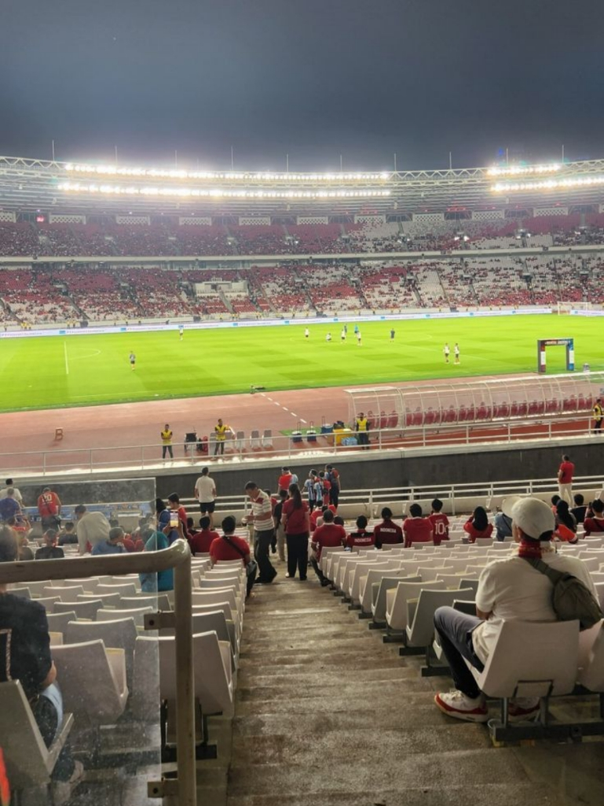
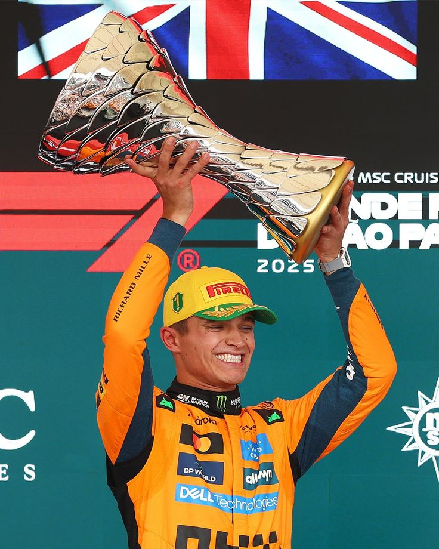

never forget who made you successful

<!DOCTYPE html>
<html lang="id">
<head>
<meta charset="UTF-8">
<meta name="viewport" content="width=device-width, initial-scale=1.0">
<meta name="theme-color" content="#080b0a">
<title>REZKY ADITYA | Personal Website</title>

</head>

<body>

<header>
  

    <a class="logo" href="#home">REZKY ADITYA.</a>

    <nav class="nav-links">
      <a href="#home">Home</a>
      <a href="#tentang">Tentang</a>
      <a href="#hobi">Hobi</a>
      <a href="#kontak">Kontak</a>
    </nav>
  

</header>

<main>
  <!-- HOME -->
  <section class="container hero" id="home">
    

      PERSONAL WEBSITE

      <h1>Halo, Saya REZKY ADITYA</h1>

      

        Selamat datang di website pribadi saya.
        Di sini kamu bisa mengenal saya lebih dekat,
        melihat hobi saya, dan menghubungi saya melalui
        media sosial.
      

      

        <a class="btn btn-primary" href="#tentang">Tentang Saya</a>

        <a class="btn btn-secondary"
           href="https://wa.me/6283897256809"
           target="_blank" rel="noopener noreferrer">

          
            <svg viewBox="0 0 24 24">
              <path d="M20.5 3.5A11.8 11.8 0 0 0 12.1 0C5.6 0 .3 5.3.3 11.8c0 2.1.6 4.2 1.6 6L0 24l6.4-1.7a12 12 0 0 0 5.7 1.4h.1c6.5 0 11.8-5.3 11.8-11.8 0-3.2-1.2-6.2-3.5-8.4ZM12.1 21.7c-1.8 0-3.5-.5-5-1.4l-.4-.2-3.8 1 1-3.7-.3-.4a9.8 9.8 0 1 1 8.5 4.7Zm5.4-7.3c-.3-.2-1.8-.9-2.1-1-.3-.1-.5-.2-.7.2-.2.3-.8 1-1 1.2-.2.2-.4.2-.7.1-.3-.2-1.3-.5-2.5-1.5-.9-.8-1.5-1.8-1.7-2.1-.2-.3 0-.5.1-.7l.5-.6c.2-.2.2-.3.3-.6.1-.2 0-.4 0-.6-.1-.2-.7-1.7-.9-2.3-.3-.6-.5-.5-.7-.5h-.6c-.2 0-.6.1-.9.4-.3.3-1.2 1.2-1.2 2.8s1.2 3.2 1.4 3.4c.2.2 2.4 3.7 5.8 5.1.8.4 1.5.6 2 .7.8.3 1.6.2 2.2.1.7-.1 1.8-.7 2-1.4.3-.7.3-1.3.2-1.4-.1-.2-.3-.3-.6-.4Z"/>
            </svg>
          
          WhatsApp
        </a>
      

    

    

      
    

  </section>

  <!-- TENTANG SAYA -->
  <section class="section" id="tentang">
    

      <h2 class="section-title">Tentang Saya</h2>
      
Sedikit informasi tentang diri saya.

      

        

          Halo! Saya <strong>REZKY ADITYA</strong>.
          Saya adalah siswa kelas XII TKJ 1.
          Saya suka melakukan berbagai kegiatan,
          terutama bermain bola, jalan-jalan, dan menonton Formula 1.
        

        

          

            Nama Lengkap
            REZKY ADITYA
          

          

            Kelas
            XII TKJ 1
          

          

            WhatsApp
            
              <a href="https://wa.me/6283897256809"
                 target="_blank" rel="noopener noreferrer">
                0838-9725-6809
              </a>
            
          

          

            Instagram
            
              <a href="https://instagram.com/kyy_cavalry"
                 target="_blank" rel="noopener noreferrer">
                @kyy_cavalry
              </a>
            
          

        

        

          ⚽ Bermain Bola
          🌄 Jalan jalan
          🏎️ Menonton Formula 1
        

      

    

  </section>

  <!-- POSTINGAN HOBI -->
  <section class="section" id="hobi">
    

      <h2 class="section-title">Hal yang Saya Suka</h2>
      

        Beberapa hobi saya dalam tampilan seperti postingan Instagram.
      

      

        <!-- POST 1: SEPAK BOLA -->
        <article class="post" data-id="bola">
          

            
            

              
kyy_cavalry

              
⚽ Sepak Bola

            

          

          

          

            <button class="action-btn like-btn" aria-label="Like postingan">
              <svg viewBox="0 0 24 24">
                <path d="M20.8 4.6a5.5 5.5 0 0 0-7.8 0L12 5.7l-1.1-1.1a5.5 5.5 0 0 0-7.8 7.8l1.1 1.1L12 21l7.8-7.5 1.1-1.1a5.5 5.5 0 0 0-.1-7.8Z"/>
              </svg>
            </button>

            <button class="action-btn comment-focus" aria-label="Komentar">
              <svg viewBox="0 0 24 24">
                <path d="M21 11.5a8.4 8.4 0 0 1-.9 3.8 8.5 8.5 0 0 1-7.6 4.7 8.4 8.4 0 0 1-3.8-.9L3 21l1.9-5.7a8.4 8.4 0 0 1-.9-3.8 8.5 8.5 0 0 1 4.7-7.6 8.4 8.4 0 0 1 3.8-.9h.5a8.5 8.5 0 0 1 8 8v.5Z"/>
              </svg>
            </button>

            <button class="action-btn share-btn" aria-label="Bagikan postingan">
              <svg viewBox="0 0 24 24">
                <path d="m22 2-7 20-4-9-9-4Z"/>
                <path d="M22 2 11 13"/>
              </svg>
            </button>
          

          
0 suka

          

            <strong>kyy_cavalry</strong>
            Bermain bola adalah salah satu hobi favorit saya! ⚽🔥
          

          

          <form class="comment-form">
            <input type="text" placeholder="Tambahkan komentar..."
                   aria-label="Tulis komentar" maxlength="300">
            <button type="submit">Kirim</button>
          </form>
        </article>

        <!-- POST 2: JALAN-JALAN -->
        <article class="post" data-id="jalan">
          

            
            

              
kyy_cavalry

              
🌄 Jalan-jalan

            

          

          

          

            <button class="action-btn like-btn" aria-label="Like postingan">
              <svg viewBox="0 0 24 24">
                <path d="M20.8 4.6a5.5 5.5 0 0 0-7.8 0L12 5.7l-1.1-1.1a5.5 5.5 0 0 0-7.8 7.8l1.1 1.1L12 21l7.8-7.5 1.1-1.1a5.5 5.5 0 0 0-.1-7.8Z"/>
              </svg>
            </button>

            <button class="action-btn comment-focus" aria-label="Komentar">
              <svg viewBox="0 0 24 24">
                <path d="M21 11.5a8.4 8.4 0 0 1-.9 3.8 8.5 8.5 0 0 1-7.6 4.7 8.4 8.4 0 0 1-3.8-.9L3 21l1.9-5.7a8.4 8.4 0 0 1-.9-3.8 8.5 8.5 0 0 1 4.7-7.6 8.4 8.4 0 0 1 3.8-.9h.5a8.5 8.5 0 0 1 8 8v.5Z"/>
              </svg>
            </button>

            <button class="action-btn share-btn" aria-label="Bagikan postingan">
              <svg viewBox="0 0 24 24">
                <path d="m22 2-7 20-4-9-9-4Z"/>
                <path d="M22 2 11 13"/>
              </svg>
            </button>
          

          
0 suka

          

            <strong>kyy_cavalry</strong>
            Menjelajahi tempat baru dan menikmati pemandangan. 🌄✨
          

          

          <form class="comment-form">
            <input type="text" placeholder="Tambahkan komentar..."
                   aria-label="Tulis komentar" maxlength="300">
            <button type="submit">Kirim</button>
          </form>
        </article>

        <!-- POST 3: FORMULA 1 -->
        <article class="post" data-id="f1">
          

            
            

              
kyy_cavalry

              
🏎️ Formula 1

            

          

          

          

            <button class="action-btn like-btn" aria-label="Like postingan">
              <svg viewBox="0 0 24 24">
                <path d="M20.8 4.6a5.5 5.5 0 0 0-7.8 0L12 5.7l-1.1-1.1a5.5 5.5 0 0 0-7.8 7.8l1.1 1.1L12 21l7.8-7.5 1.1-1.1a5.5 5.5 0 0 0-.1-7.8Z"/>
              </svg>
            </button>

            <button class="action-btn comment-focus" aria-label="Komentar">
              <svg viewBox="0 0 24 24">
                <path d="M21 11.5a8.4 8.4 0 0 1-.9 3.8 8.5 8.5 0 0 1-7.6 4.7 8.4 8.4 0 0 1-3.8-.9L3 21l1.9-5.7a8.4 8.4 0 0 1-.9-3.8 8.5 8.5 0 0 1 4.7-7.6 8.4 8.4 0 0 1 3.8-.9h.5a8.5 8.5 0 0 1 8 8v.5Z"/>
              </svg>
            </button>

            <button class="action-btn share-btn" aria-label="Bagikan postingan">
              <svg viewBox="0 0 24 24">
                <path d="m22 2-7 20-4-9-9-4Z"/>
                <path d="M22 2 11 13"/>
              </svg>
            </button>
          

          
0 suka

          

            <strong>kyy_cavalry</strong>
            Kecepatan, strategi, dan persaingan seru di Formula 1! 🏁🔥
          

          

          <form class="comment-form">
            <input type="text" placeholder="Tambahkan komentar..."
                   aria-label="Tulis komentar" maxlength="300">
            <button type="submit">Kirim</button>
          </form>
        </article>

      

    

  </section>

  <!-- KONTAK -->
  <section class="section" id="kontak">
    

      

        <h2 class="section-title">Hubungi Saya</h2>
        

          Ingin menyapa atau mengobrol? Silakan hubungi saya
          melalui WhatsApp atau kunjungi Instagram saya.
        

        

          <a class="btn btn-primary"
             href="https://wa.me/6283897256809"
             target="_blank" rel="noopener noreferrer">

            
              <svg viewBox="0 0 24 24">
                <path d="M20.5 3.5A11.8 11.8 0 0 0 12.1 0C5.6 0 .3 5.3.3 11.8c0 2.1.6 4.2 1.6 6L0 24l6.4-1.7a12 12 0 0 0 5.7 1.4h.1c6.5 0 11.8-5.3 11.8-11.8 0-3.2-1.2-6.2-3.5-8.4ZM12.1 21.7c-1.8 0-3.5-.5-5-1.4l-.4-.2-3.8 1 1-3.7-.3-.4a9.8 9.8 0 1 1 8.5 4.7Zm5.4-7.3c-.3-.2-1.8-.9-2.1-1-.3-.1-.5-.2-.7.2-.2.3-.8 1-1 1.2-.2.2-.4.2-.7.1-.3-.2-1.3-.5-2.5-1.5-.9-.8-1.5-1.8-1.7-2.1-.2-.3 0-.5.1-.7l.5-.6c.2-.2.2-.3.3-.6.1-.2 0-.4 0-.6-.1-.2-.7-1.7-.9-2.3-.3-.6-.5-.5-.7-.5h-.6c-.2 0-.6.1-.9.4-.3.3-1.2 1.2-1.2 2.8s1.2 3.2 1.4 3.4c.2.2 2.4 3.7 5.8 5.1.8.4 1.5.6 2 .7.8.3 1.6.2 2.2.1.7-.1 1.8-.7 2-1.4.3-.7.3-1.3.2-1.4-.1-.2-.3-.3-.6-.4Z"/>
              </svg>
            
            WhatsApp
          </a>

          <a class="btn btn-secondary"
             href="https://instagram.com/kyy_cavalry"
             target="_blank" rel="noopener noreferrer">

            
              <svg viewBox="0 0 24 24">
                <path d="M7 2h10a5 5 0 0 1 5 5v10a5 5 0 0 1-5 5H7a5 5 0 0 1-5-5V7a5 5 0 0 1 5-5Zm0 2.2A2.8 2.8 0 0 0 4.2 7v10A2.8 2.8 0 0 0 7 19.8h10a2.8 2.8 0 0 0 2.8-2.8V7A2.8 2.8 0 0 0 17 4.2H7ZM12 7a5 5 0 1 1 0 10 5 5 0 0 1 0-10Zm0 2.2a2.8 2.8 0 1 0 0 5.6 2.8 2.8 0 0 0 0-5.6ZM17.5 5.5a1.2 1.2 0 1 1 0 2.4 1.2 1.2 0 0 1 0-2.4Z"/>
              </svg>
            
            Instagram
          </a>
        

      

    

  </section>
</main>

<footer>
  

    © 2026 REZKY ADITYA · Dibuat dengan semangat.
  

</footer>

</body>
</html>
